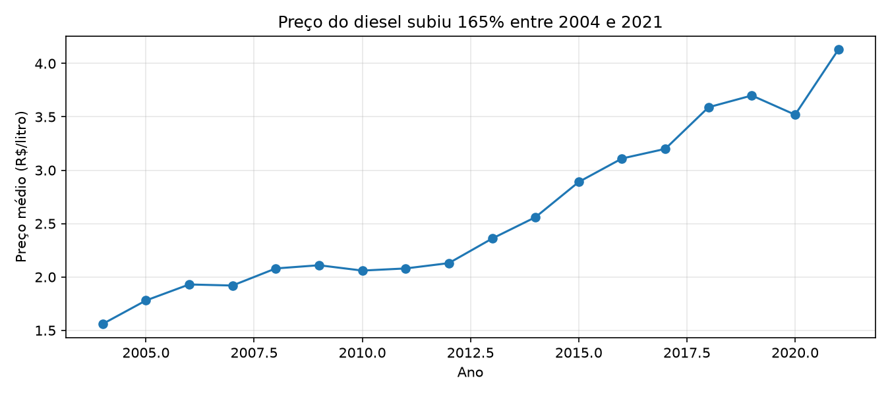
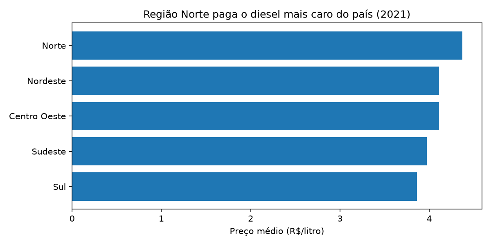

# Custo do diesel no Brasil (2004–2021)

Análise do preço do óleo diesel, principal combustível do transporte de cargas,
usando dados públicos da ANP. O projeto passa por todo o fluxo de dados:
**Python** para limpar, **SQL** para consultar e **Excel** para entregar o relatório.

## Principais resultados

- O diesel subiu **165%** no período: de **R$ 1,56** (2004) para **R$ 4,13** (2021).
- A região **Norte** paga o diesel mais caro do país (R$ 4,37/litro em 2021),
  e o **Sul**, o mais barato (R$ 3,86/litro).
- O **Acre** tem o diesel mais caro entre os estados (R$ 5,19/litro), e 4 dos 5
  estados mais caros são do Norte.
- Em **2020** o preço caiu, efeito da pandemia sobre a demanda e o petróleo.

## Como foi feito

1. **Limpeza (Python/Pandas):** junção de duas bases de períodos diferentes,
   conversão de datas e correção de nomes de produto escritos de dois jeitos
   ("ÓLEO DIESEL" e "OLEO DIESEL"), que dividiam o mesmo produto em dois.
2. **Banco de dados (SQLite):** os dados limpos foram gravados numa tabela SQL.
3. **Análise (SQL):** consultas com GROUP BY, AVG, subconsulta e LIMIT
   para responder às perguntas.
4. **Visualização (Matplotlib):** gráficos com o título contando a conclusão.
5. **Relatório (Excel):** arquivo relatorio_diesel.xlsx com 4 abas
   (resumo, evolução anual, por região e top 5 estados).

## Observação sobre os dados

Os dados de 2021 cobrem apenas parte do ano, então a média de 2021 é parcial.

## Ferramentas

Python · Pandas · SQLite · SQL · Matplotlib · Excel · Jupyter

## Fonte dos dados

[Gas Prices in Brazil (Kaggle)](https://www.kaggle.com/datasets/matheusfreitag/gas-prices-in-brazil),
levantamento de preços da ANP.

## Como rodar

Instale as bibliotecas com `pip install pandas matplotlib openpyxl jupyterlab`,
abra o `projeto_combustiveis.ipynb` no Jupyter e rode todas as células.

---
Feito por **Mateus Corrêa** · [GitHub](https://github.com/mateuskauadev)